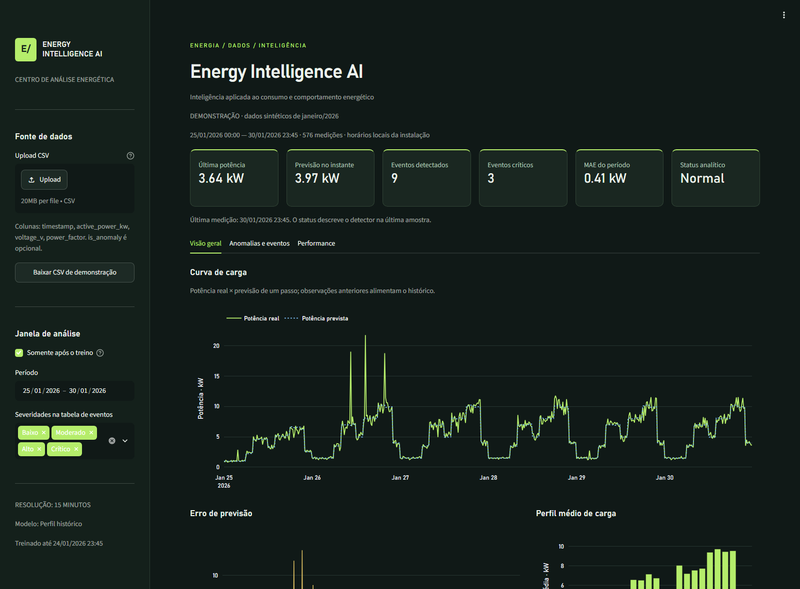
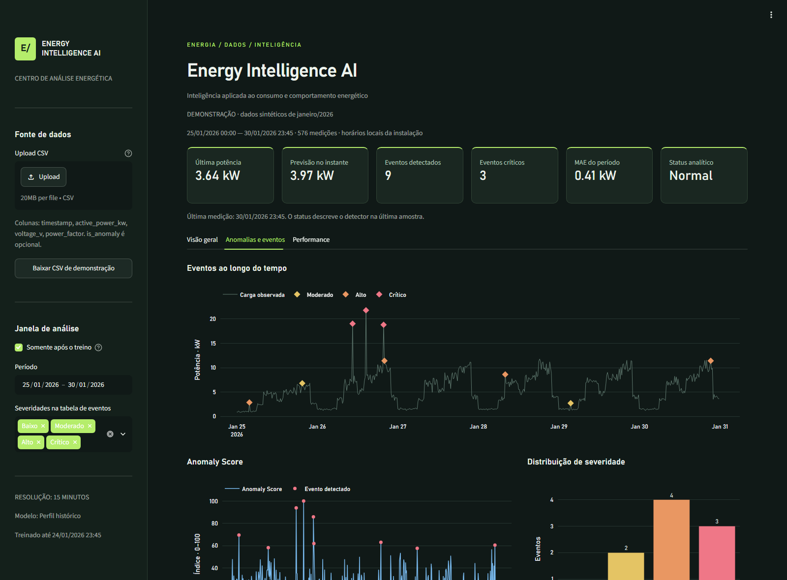
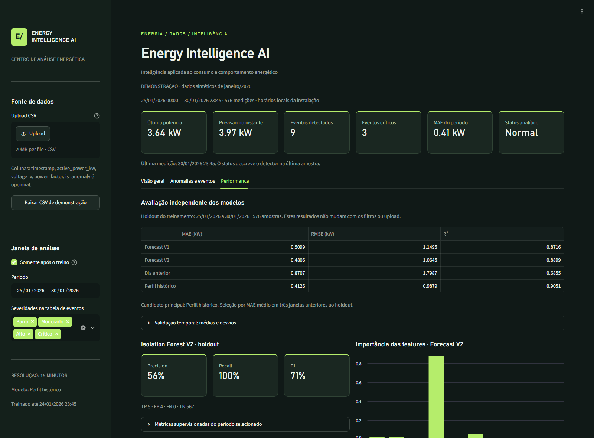
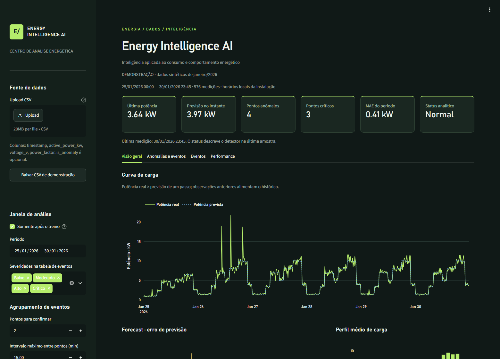
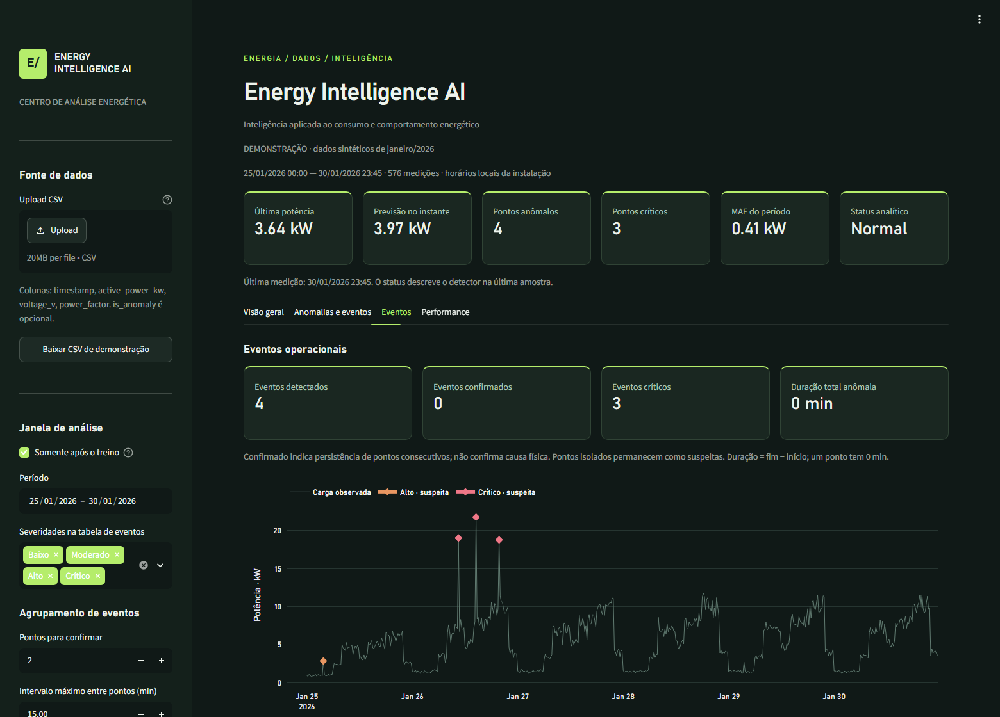
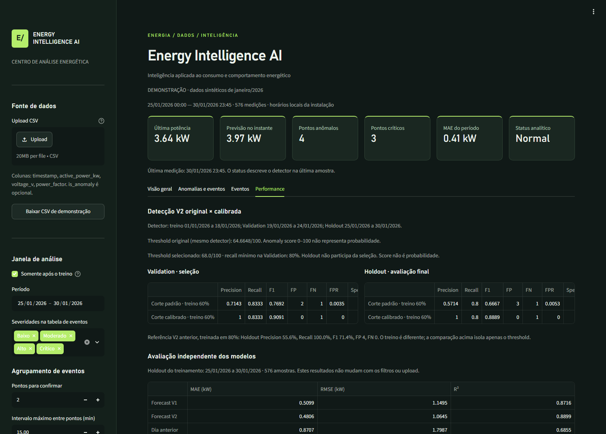

# Energy Intelligence AI

Inteligência aplicada ao consumo e comportamento energético. MVP em Python que
transforma medições elétricas em previsões, eventos interpretáveis e visualizações.
Desenvolvido como projeto de portfólio com dados sintéticos; os resultados abaixo
não representam validação em instalações reais.



## Visão geral

- Isolation Forest V2 com referência de potência por horário ajustada no treino.
- Score relativo 0–100, severidade Normal/Baixo/Moderado/Alto/Crítico e mensagens.
- Forecast V1 e V2, baselines diário e de perfil; validação temporal em três janelas.
- Persistência de modelos, preprocessamento e calibração, sem treino na inferência.
- API FastAPI/Pydantic e dashboard Streamlit com Plotly.
- Demo automático, upload CSV validado, filtros e download de análise/eventos.
- Curva real × prevista, anomalias, score, severidade, erro e perfil de carga.
- Métricas supervisionadas somente para observações com ground truth explícito.

## Problema

Medições individuais de consumo são difíceis de interpretar sem um perfil de
referência. Este projeto compara carga observada e esperada, destaca desvios e
agrupa detecções em eventos para apoiar uma análise humana. Não diagnostica
curto-circuito, falha, sobrecarga, fraude ou furto.

## Como executar

Ambiente verificado em Python 3.13.5; use Python 3.13 também no deploy.
Na raiz do projeto, PowerShell:

```powershell
# Crie o ambiente somente se ainda não existir:
python -m venv .venv
.\.venv\Scripts\python.exe -m pip install -r requirements.txt
# Para testes e notebooks:
.\.venv\Scripts\python.exe -m pip install -r requirements-dev.txt
# Necessário para API local; opcional para o dashboard demo:
.\.venv\Scripts\python.exe -m src.train
```

Em terminais separados:

```powershell
.\.venv\Scripts\python.exe -m uvicorn app.api:app --reload
.\.venv\Scripts\python.exe -m streamlit run app/dashboard.py
```

Dashboard: http://localhost:8501. API/documentação interativa:
http://localhost:8000/docs. Saúde/prontidão: http://localhost:8000/health.
Com o ambiente ativado, os comandos equivalentes são `python -m src.train`,
`uvicorn app.api:app --reload` e `streamlit run app/dashboard.py`.

```powershell
.\.venv\Scripts\python.exe -m pytest -q
```

Para outro dataset de treinamento:

```powershell
.\.venv\Scripts\python.exe -m src.train --data caminho/dataset.csv
```

Upload no dashboard apenas aplica os modelos persistidos. Para ajustar outra
instalação, execute o treino explicitamente e reinicie a API. O dashboard invalida
o cache quando os arquivos dos modelos mudam. O treinamento exige ao menos
1.200 medições contínuas de 15 minutos, para acomodar histórico e validação.

## Como publicar no Streamlit

1. Revise e publique os arquivos selecionados no seu repositório GitHub.
2. Em Streamlit Community Cloud, escolha o repositório, branch e o arquivo
   **`app/dashboard.py`**.
3. Em **Advanced settings → Python version**, selecione **3.13**.
4. Não configure secrets: o demo não usa `.env`, APIs externas ou credenciais.
5. Confirme que `data/raw/energy_consumption_30days.csv`, `app/`, `src/`,
   `requirements.txt` e `.streamlit/config.toml` estão no repositório.

A estratégia de artefatos é **B: preparo pequeno e seguro no startup**.
Sem modelos locais válidos, `app/resources.py` prepara o demo original de 2.880
pontos uma vez por processo e mantém pipeline/métricas em `st.cache_resource`.
O primeiro acesso pode levar alguns segundos; filtros e uploads reutilizam o
cache. Reiniciar o servidor ou limpar o cache exige novo preparo. Somente o CSV
demo com hash conhecido pode alimentar esse preparo; uploads nunca treinam.
Modelos ausentes, corrompidos ou métricas inválidas ativam um aviso explícito de
modo demo. A API permanece independente e exige `python -m src.train`.

As nove dependências de runtime estão fixadas; testes, notebooks e ferramentas
do navegador ficam em `requirements-dev.txt`. A configuração de Python é feita
no painel do serviço, conforme a [documentação oficial de deploy](https://docs.streamlit.io/deploy/streamlit-community-cloud/deploy-your-app/deploy).
Não se depende de `runtime.txt` para selecionar Python nesse serviço.

## Arquitetura

```text
CSV → validação → features contextuais/causais → treino + validação temporal
                                                ↓
                                       models/*.joblib + métricas
                                                ↓
                                     EnergyPipeline (sem fit)
                                       ↙                 ↘
                              FastAPI                 Streamlit/Plotly
```

API e dashboard são consumidores independentes do mesmo pipeline; o dashboard
funciona diretamente com os artefatos e não depende de a API estar iniciada.

```text
energy-intelligence-ai/
├── data/
│   ├── raw/energy_consumption_30days.csv  # Demo original preservado
│   ├── processed/
│   └── outputs/                         # CSVs gerados pelo treino
├── models/                              # joblib + metrics.json locais
├── notebooks/
│   ├── 01_exploratory_analysis.ipynb     # Original preservado
│   ├── 02_mvp_model_evaluation.ipynb     # Comparações e resultados executados
│   └── 03_anomaly_calibration_and_events.ipynb # Calibração, PR e eventos
├── src/
│   ├── generate_dataset.py              # Gerador original preservado
│   ├── data_processing.py
│   ├── feature_engineering.py
│   ├── anomaly_detection.py
│   ├── anomaly_calibration.py
│   ├── config.py
│   ├── events.py
│   ├── forecasting.py
│   ├── severity.py
│   ├── inference.py
│   ├── train.py
│   └── utils.py
├── app/{api.py,dashboard.py,charts.py,event_views.py}
├── tests/
├── docs/{implementation_plan.md,screenshots/}
├── reports/{model_metrics.json,development_report.md}
├── .streamlit/config.toml
├── pytest.ini
├── requirements.txt
└── README.md
```

## Stack

Runtime: pandas, NumPy, scikit-learn, joblib, FastAPI/Pydantic/Uvicorn e
Streamlit/Plotly. Desenvolvimento: Matplotlib, pytest/httpx, Jupyter/ipykernel
e Playwright. Versões verificadas no [requirements.txt](requirements.txt).

## Dataset

Dataset **sintético**, com 2.880 medições de 15 minutos entre 01 e 30/01/2026,
uma instalação e 20 pontos anômalos inseridos. Campos: timestamp,
active_power_kw, voltage_v, current_a, power_factor, energy_kwh e is_anomaly.
O demo preserva o CSV e o gerador originais. Ground truth é opcional em uploads;
sem rótulos, o app mantém inferência/eventos e omite métricas supervisionadas.

## Anomaly Detection

Isolation Forest com cinco variáveis elétricas/contextuais e perfil horário
congelado no treino. A escala 0–100 também é congelada no treino.
**Anomaly score 0–100 não representa probabilidade.** Severidades e mensagens
descrevem desvio de carga sem atribuir causas físicas.

## Resultados

O notebook original conserva os resultados exploratórios históricos:

| Detecção | Precision | Recall | F1 | Eventos reais detectados |
|---|---:|---:|---:|---:|
| V1 — variáveis elétricas | ≈55% | ≈55% | ≈55% | 11/20 |
| V2 — contexto horário | ≈80% | ≈80% | ≈80% | 16/20 |

Essas métricas foram obtidas ajustando e avaliando no mesmo dataset. O MVP usa
um protocolo separado: treino de **01 a 24/01/2026** (2.304 amostras), holdout
**25 a 30/01/2026** (576 amostras). O holdout nunca participa da seleção do modelo.

| Forecast — mesmo holdout | MAE (kW) | RMSE (kW) | R² |
|---|---:|---:|---:|
| V1 · Random Forest temporal | 0,5099 | 1,1495 | 0,8716 |
| V2 · Random Forest com histórico | 0,4806 | 1,0645 | 0,8899 |
| Baseline · mesmo instante do dia anterior | 0,8707 | 1,7987 | 0,6855 |
| **Baseline · mediana por hora/tipo de dia** | **0,4126** | **0,9879** | **0,9051** |

V1 reproduz MAE ≈0,51 kW, RMSE ≈1,15 kW e R² ≈0,872 do notebook.
V2 melhora o MAE em cerca de 5,7%, mas a mediana histórica supera os dois modelos
neste demo e é o candidato principal. A escolha usa o menor MAE médio de três
janelas temporais **dentro do treino**. Médias, desvios e intervalos de cada janela
estão em [reports/model_metrics.json](reports/model_metrics.json) e no dashboard.

Referência do Isolation Forest V2 antes da calibração (treino em 80%):

| Precision | Recall | F1 | TP | FP | FN | TN |
|---:|---:|---:|---:|---:|---:|---:|
| 55,6% | 100% | 71,4% | 5 | 4 | 0 | 567 |

A matriz de confusão, com linhas reais e colunas previstas [normal, anomalia],
é `[[567, 4], [0, 5]]`. Cinco eventos são insuficientes para concluir estabilidade
ou generalização. O relatório distingue diagnóstico de treino e avaliação holdout.

## Threshold Calibration

A Etapa 2 reserva validação para escolher o corte do score, reduzindo falsos
positivos sem consultar o holdout. Divisão temporal do detector:

| Conjunto | Período de janeiro/2026 | Medições | Uso |
|---|---|---:|---|
| Treino · 60% | 01–18 | 1.728 | Isolation Forest, perfil horário e escala do score |
| Validation · 20% | 19–24 | 576 | Seleção do threshold |
| Holdout · 20% | 25–30 | 576 | Avaliação final, após a seleção |

Os períodos completos estão em `reports/model_metrics.json`. Forecasting conserva
treino em 80% com CV interna; o detector não é refitado depois da calibração.

A grade testa 0–100 em passos de 1. A política maximiza F1 com recall ≥80% na
Validation; empata por menos FP e depois maior threshold. **Threshold escolhido:
68/100**, aplicado como `score >= 68`. No detector treinado em 60%, o corte padrão
equivale a aproximadamente **64,6648/100** (`decision_function < 0`). O corte do
modelo histórico de 80% equivale a 57,3000/100, em outra escala de score.
O score continua **não sendo probabilidade**.

| Avaliação | Detector/corte | Precision | Recall | F1 | FP | FN |
|---|---|---:|---:|---:|---:|---:|
| Validation | Treino 60%, padrão | 71,4% | 83,3% | 76,9% | 2 | 1 |
| Validation | Treino 60%, calibrado | 100% | 83,3% | 90,9% | 0 | 1 |
| Holdout | Referência anterior, treino 80% | 55,6% | 100% | 71,4% | 4 | 0 |
| Holdout | Treino 60%, padrão | 57,1% | 80% | 66,7% | 3 | 1 |
| Holdout | Treino 60%, calibrado | 100% | 80% | 88,9% | 0 | 1 |

A mudança completa reduziu FP de 4 para 0 e aumentou FN de 0 para 1. Comparando
o **mesmo detector de 60%**, o threshold reduziu FP de 3 para 0, mantendo FN=1
e recall=80%. Não se atribui a alteração do recall somente ao threshold.
Holdout calibrado: TP=4, TN=571, matriz `[[571,0],[1,4]]`, FPR=0,
specificity=1 e balanced accuracy=0,9. Validation tem seis positivos e Holdout
somente cinco; estes números não demonstram estabilidade em instalações reais.

`src/config.py` centraliza `MIN_RECALL`, `THRESHOLD_GRID` e a fração de treino.
Sem rótulos, sem ambas as classes ou sem threshold viável, conserva-se o corte
padrão com motivo explícito. Testes rejeitam treino/holdout na função de calibração
e alteram todo o holdout sem modificar threshold, tabela de validação ou detector.
Artefatos persistem a política, as fronteiras e a identidade do dataset.

```powershell
.\.venv\Scripts\python.exe -m src.train --min-recall 0.80
```

## Operational Events

`build_anomaly_events` transforma pontos anômalos adjacentes em eventos. O gap
máximo padrão é 15 min; uma medição normal sempre interrompe o grupo. Um ponto
fica `suspected`; dois ou mais ficam `confirmed`, significando **persistência**,
sem confirmar causa física. A regra é configurável e pontos isolados são mantidos.

Cada evento contém ID derivado do início, início/fim, duração, quantidade de
pontos, potência máxima/média, potência esperada média, desvio relativo de maior
magnitude com sinal, score máximo/médio, maior severidade dos pontos, status e
mensagem. Referências próximas de zero tornam o percentual indisponível.
Duração = fim − início: 18:15/18:30/18:45 formam 30 min; um ponto tem 0 min.

O demo completo gerou 19 eventos isolados (9 Alto, 10 Crítico). No Holdout há
4 suspeitas, nenhuma confirmação por persistência, 1 Alto e 3 Crítico. Duração
total=0 min porque todos são pontos isolados. Sequências persistentes são cobertas
por testes e por exemplo didático no notebook 03, sem entrar nas métricas do demo.

`EnergyPipeline.analyze` mantém o DataFrame por linha; `analyze_with_events`
adiciona `results`, `events` e `summary`. API, pipeline e dashboard usam a política
persistida pelo treino quando não há override. Eventos são agregados do lote
fornecido; não há armazenamento nem continuidade entre chamadas. A aba Eventos
mostra cards, timeline, tabela e exportação; filtros de data conservam eventos
completos que intersectam a janela elegível.

```powershell
.\.venv\Scripts\python.exe -m src.train --min-event-points 2 --max-event-gap-minutes 15
```

[Notebook 03](notebooks/03_anomaly_calibration_and_events.ipynb) documenta a grade,
curva Precision–Recall de Validation, seleção, Holdout e agregação de eventos.

## Features e prevenção de vazamento

V1: `hour`, `minute`, `weekday`, `day`, `month` e 200 árvores, random_state=42.
V2 adiciona `lag_1`, `lag_4`, `lag_96`, `lag_672`, `rolling_mean_4`,
`rolling_mean_96`, `rolling_std_4`, `rolling_std_96`; folhas mínimas de 4 amostras.

- Lags correspondem a 15 min, 1 h, 24 h e 7 dias em uma grade temporal explícita.
- Rolling usa `shift(1)` antes da janela; a própria observação prevista é excluída.
- Lacunas preservam a duração dos lags e deixam features indisponíveis.
- Medianas por horário/tipo de dia são aprendidas somente no treino de cada janela.
- Forecasting usa observações anteriores reais: **previsão de um passo**, sem
  simular um horizonte futuro de vários dias.
- O histórico exigido depende do candidato selecionado: V1 usa apenas o horário;
  perfil histórico usa as medianas congeladas do treino; dia anterior requer a
  medição de 24 horas atrás; V2 requer todas as suas features, incluindo sete dias.
  Somente diário/V2 usam `forecast_v1_fallback` quando faltam as features exigidas.
  O perfil produz a mesma previsão para um instante analisado sozinho ou em lote.
- `model_training_overlap` identifica instantes expostos ao ajuste/seleção;
  o dashboard exibe o holdout por padrão e avisa quando inclui esse horizonte.
- Importância de features é descritiva e não representa causalidade.

O detector V2 mantém `voltage_v`, `power_factor`, `active_power_kw`,
`desvio_potencia` e `razao_potencia`. A contaminação de demonstração é a configuração
fixa `20/2880`; não se calcula a partir dos rótulos do upload/holdout.

## Score e severidade

```text
raw = -IsolationForest.decision_function(features)
score = clip(100 × (raw - min_treino) / (max_treino - min_treino), 0, 100)
```

Maior score indica comportamento mais anômalo; extremos novos são limitados.
Mínimo/máximo são persistidos, portanto o score não muda com o tamanho do lote.
O score **não é probabilidade estatística**. Para intervalos degenerados de
calibração, o denominador tem limite inferior de 1e-12.

Medições não detectadas são sempre **Normal**. Somente eventos recebem:
Baixo <40, Moderado <60, Alto <80, Crítico ≥80. Os thresholds estão centralizados
em `src/severity.py`. Mensagens mostram potência observada, potência típica,
desvio relativo (positivo ou negativo) e score; não atribuem causas elétricas.

## Forecasting

V1 usa calendário; V2 acrescenta lags e estatísticas móveis causais. São previsões
**one-step de 15 minutos**, com observações anteriores reais disponíveis a cada
instante. O treino usa os primeiros 80%, três janelas internas de validação e
holdout final de 20%. Nenhum candidato é escolhido pelo resultado no holdout.

## Baselines

O dia anterior usa o mesmo horário 24 horas antes. O perfil histórico usa medianas
por hora/tipo de dia aprendidas no treino. Neste dataset, o perfil histórico vence
V1 e V2 e é o candidato servido; não há alegação de superioridade de ML.

## Contrato de dados

CSV UTF-8, separado por vírgulas, uma instalação por arquivo:

```csv
timestamp,active_power_kw,voltage_v,power_factor
2026-02-01 12:00:00,5.2,127.0,0.94
2026-02-01 12:15:00,5.4,126.8,0.93
```

Para anomalias/análise são obrigatórias as quatro colunas. Forecasting isolado
exige apenas timestamp e active_power_kw. `current_a`, `energy_kwh` e `is_anomaly`
são opcionais; rótulos ausentes nunca são preenchidos artificialmente. Métricas
supervisionadas usam apenas linhas explicitamente rotuladas e indicam a quantidade.

Timestamps locais sem timezone, alinhados a 15 min, únicos; o pipeline ordena uma
cópia. Potência/corrente/energia não negativas, tensão positiva, fator de potência
em (0,1]; is_anomaly em {0,1}. Inputs usados pelo modelo devem estar completos e
finitos. CSV com cabeçalhos duplicados ou linhas malformadas é rejeitado.
Upload até 20 MB, 100 mil linhas e intervalo de até 366 dias. Lacunas são aceitas
na inferência com fallback; treinamento requer série contínua.

## API

| Endpoint | Entrada | Comportamento |
|---|---|---|
| GET /health | — | Prontidão, modelo selecionado e término de treino |
| POST /predict/anomaly | records | Detector, score, severidade e mensagem |
| POST /predict/forecast | history, timestamp opcional | Próximo intervalo de 15 minutos |
| POST /analyze | records, history opcional | Anomalia + potência prevista + erro |
| POST /analyze/events | records, history e política opcionais | Resumo + eventos agregados |

`records`: de 1 a 5.000 medições elétricas. `history`: até 4.096 observações
anteriores, contendo timestamp/active_power_kw. Todos os horários do histórico
precisam ser anteriores à primeira medição analisada. A previsão futura exige
somente o próximo intervalo após a última observação, sem inventar o alvo futuro.

```json
{
  "records": [{
    "timestamp": "2026-02-01T12:00:00",
    "active_power_kw": 30.0,
    "voltage_v": 127.0,
    "power_factor": 0.94
  }]
}
```

Envie para `/analyze`. A resposta contém `results` com timestamp, potência,
`expected_power_kw`/`predicted_power_kw`, `forecast_error_kw`, `forecast_source`,
`is_anomaly_prediction`/`anomaly`, score, severidade, mensagem e sobreposição de
treino; `anomaly_metrics` é null sem ground truth. Dados inválidos retornam 422;
modelos ausentes/corrompidos/incompatíveis retornam prontidão 503 e orientação para
executar treino. Artefatos joblib são locais e não são aceitos como upload.

`/analyze/events` aceita os mesmos `records`/`history`, além de
`min_event_points` e `max_gap_minutes` opcionais. Omiti-los usa a política dos
modelos persistidos. A resposta contém `summary` (total/confirmados/críticos/duração),
`events` e `anomaly_metrics`. Os endpoints anteriores conservam seus schemas.

## Artefatos e screenshots

Treino gera `models/anomaly_model.joblib`, `models/forecast_model.joblib` (inclui
V1/V2, perfil e seleção), `models/metrics.json` e `reports/model_metrics.json`.
CSVs em `data/outputs/`: `analysis_results.csv`, `forecast_results.csv`,
`anomaly_points.csv` (uma linha por ponto), `anomaly_events.csv` (uma linha por
evento) e `anomaly_thresholds.csv` (grade avaliada somente na Validation).
Modelos e CSVs gerados ficam fora do Git. Um clone inicia o dashboard com preparo
automático do demo; para gerar os outputs locais e iniciar a API, execute o treino.





## Dashboard

As quatro abas preservadas organizam as seis áreas: Visão geral contém a curva
de carga e Forecast (real × esperado, erro e perfil); Anomalias e eventos contém
pontos, score e severidade; Eventos contém agregados; Performance contém modelos
e comparações separadas de Validation/Holdout. Upload e exportação CSV estão
disponíveis também quando o demo foi preparado automaticamente.





## Testes

Testes cobrem validação, causalidade de lags/rolling, calibração estável, severidade,
mensagens, persistência sem fit, métricas com/sem rótulos, corrupção de artefatos,
API 200/422/503, requisitos de histórico por candidato, gráficos sem eventos e
dashboard com filtros. Ao trocar o CSV, a janela após treino ou os modelos, o
seletor de datas acompanha a nova janela; outros filtros preservam a escolha manual.
[Relatório de desenvolvimento](reports/development_report.md) reúne arquivos,
verificações executadas e sugestões de commits separados.
[Relatório da Etapa 2](reports/anomaly_calibration_report.md) registra calibração,
eventos, testes, verificação visual e sugestões de commits desta rodada.

A verificação final aprovou **133 testes**. Regressões incluem startup com modelos
ausentes/corrompidos, métricas inválidas, preparo limitado ao demo conhecido e
reutilização sem `fit` após interações. O notebook 03 executou oito células de
código sem erro. Consulte o [relatório final](reports/deploy_readiness_report.md)
para evidências e limitações do ambiente de verificação.

## Limitações

Limitações: 30 dias de uma série sintética, apenas cinco eventos no holdout;
thresholds/contaminação não calibrados para uma instalação real; sem ingestão em
tempo real, autenticação, banco de dados ou previsão de múltiplos passos. O modelo
é ajustado ao demo; uploads não comprovam generalização para novas instalações.

## Próximos passos

Dados reais e mais janelas temporais; validar a política de
calibração em novos períodos; validação por instalação; armazenamento e monitoramento
de drift; inferência contínua, controle de acesso e alertas com revisão humana.

Referências dos mecanismos de validação:
[TimeSeriesSplit](https://scikit-learn.org/stable/modules/generated/sklearn.model_selection.TimeSeriesSplit.html),
[FastAPI TestClient](https://fastapi.tiangolo.com/tutorial/testing/) e
[Streamlit AppTest](https://docs.streamlit.io/develop/api-reference/app-testing/st.testing.v1.apptest).

## Autor

Leandro Tenorio da Silva · projeto de portfólio Energy Intelligence AI.
